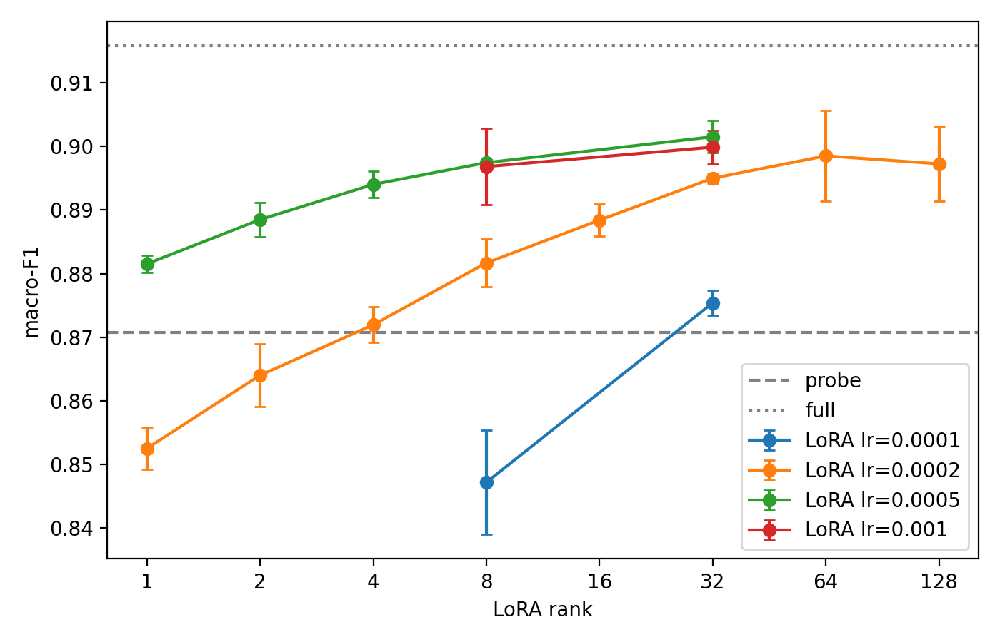
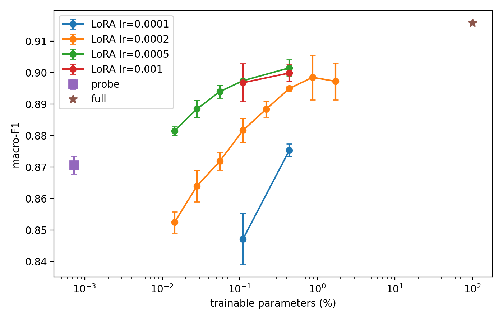
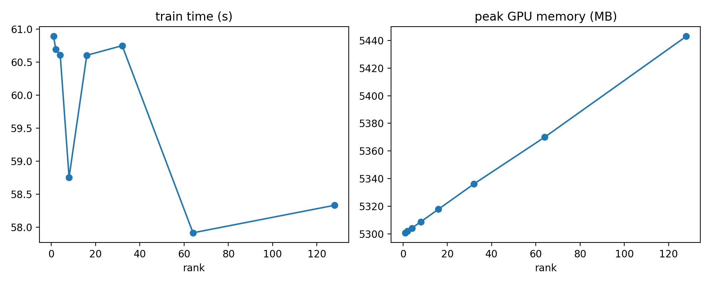
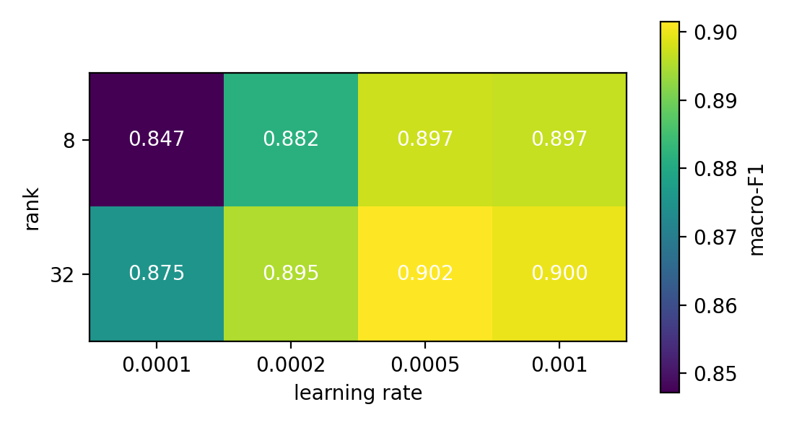

# LoRA Rank and Learning Rate: An Empirical Study on a Small Language Model

An empirical study of how LoRA rank and learning rate affect accuracy, trainable parameters and training cost when adapting Qwen2.5-0.5B for 4-class news classification (AG News). Every LoRA configuration was run with 3 seeds and compared against few-shot, linear-probe and full fine-tuning baselines.

## Summary of findings

1. **At small ranks, learning rate matters more than rank.** Rank-1 LoRA at lr 5e-4 (0.014% trainable parameters) reaches 0.8815 macro-F1, matching rank-8 at lr 2e-4 (0.8817) with 8x fewer parameters, and is above the linear probe (0.8708).
2. **The benefit of higher rank shrinks as the learning rate rises.** Going from rank 8 to rank 32 adds 2.8 points at lr 1e-4, 1.3 at 2e-4, 0.4 at 5e-4 and 0.3 at 1e-3.
3. **At lr 2e-4, gains from rank flatten around 32 to 64.** Macro-F1 is 0.8950, 0.8985 and 0.8973 for ranks 32, 64 and 128; the last two have seed spread of about 0.006 to 0.007 and are not distinguishable from rank 32.
4. **Best LoRA vs full fine-tuning.** Rank 32 at lr 5e-4 (0.44% of parameters) reaches 0.9015 +/- 0.0025, against 0.9108 +/- 0.0051 for full fine-tuning (3 seeds, lr 2e-5): a gap of about 0.9 points. LoRA recovers about 77% of the improvement from linear probe to full fine-tuning, with about 4x less training time and 1.6x less peak GPU memory.
5. **Rank has almost no effect on cost here.** Training time stays at about 58 to 61 s per run from rank 1 to 128, and peak memory rises by about 2.7%.
6. **Most errors sit at the Business / Sci-Tech boundary** (109 of 204 errors for the best LoRA run), and many of them look like ambiguous labels rather than model failures.

## Research question

How do LoRA rank and learning rate trade off classification performance, trainable parameters and training cost for a small language model?

## Experimental setup

| Item | Setting |
|---|---|
| Model | Qwen/Qwen2.5-0.5B (494.6M parameters) with a new 4-way linear classification head on the last token (3,584 parameters), via `AutoModelForSequenceClassification` |
| Dataset | AG News (`fancyzhx/ag_news`), 4 classes. Subsampled after shuffling with seed 42: 4,000 train, 500 validation (from the train split), 2,000 test (from the test split) |
| Input | Max 128 tokens, dynamic padding |
| Training | 1 epoch (250 steps), batch size 16, AdamW, linear schedule with 10% warmup, fp16 mixed precision with fp32 weights |
| LoRA | `q_proj` and `v_proj` in all 24 layers, alpha = 2 x rank, dropout 0.05; the classification head is trained as well |
| Linear probe | Backbone frozen, head only, lr 1e-3 |
| Full fine-tuning | All parameters, lr 2e-5 (1e-5 and 5e-5 tried with one seed), batch size 4 with gradient accumulation 4 (effective 16), gradient checkpointing |
| Few-shot | No training. Prompt holds 4 examples (one per class); the prediction is the label word with the highest next-token logit (first token of each label word). Single run |
| Seeds | 0, 1, 2 for every trained configuration (seed controls initialisation and data order; the data split is fixed) |
| Metrics | Macro-F1 and accuracy on the 2,000 test examples; also validation loss, trainable parameters, training time and peak GPU memory (`torch.cuda.max_memory_allocated`) |
| Hardware | Google Colab free tier, NVIDIA Tesla T4 |
| Software | Python 3.13.15, torch 2.11.0, transformers 5.18.0, peft 0.21.1, datasets 4.8.5, accelerate 1.15.0, scikit-learn 1.6.1, pandas 2.2.3, numpy 2.1.3, matplotlib 3.10.0 |

Values are mean +/- standard deviation over 3 seeds unless stated otherwise.

## Results

### Methods compared

| Method | Trainable params | Macro-F1 | Accuracy | Train time (s) | Peak memory (MB) |
|---|---:|---:|---:|---:|---:|
| Few-shot (4 shots, no training), 1 run | 0% | 0.7564 | 0.7675 | n/a (40 s inference) | 2,305 |
| Linear probe (lr 1e-3) | 0.0007% | 0.8708 +/- 0.0028 | 0.8695 | 27.8 | 2,089 |
| LoRA r=1, lr 5e-4 | 0.0144% | 0.8815 +/- 0.0014 | 0.8803 | 57.2 | 5,299 |
| LoRA r=8, lr 5e-4 | 0.1100% | 0.8975 +/- 0.0005 | 0.8965 | 58.0 | 5,306 |
| LoRA r=32, lr 5e-4 | 0.4366% | 0.9015 +/- 0.0025 | 0.9007 | 57.5 | 5,334 |
| Full fine-tuning (lr 2e-5) | 100% | 0.9108 +/- 0.0051 | 0.9100 | 239.8 | 8,741 |





### LoRA rank sweep (lr 2e-4)

| Rank | Trainable params | Macro-F1 | Accuracy | Train time (s) | Peak memory (MB) |
|---:|---:|---:|---:|---:|---:|
| 1 | 0.0144% | 0.8525 +/- 0.0033 | 0.8512 | 60.9 | 5,301 |
| 2 | 0.0281% | 0.8640 +/- 0.0050 | 0.8627 | 60.7 | 5,302 |
| 4 | 0.0554% | 0.8719 +/- 0.0028 | 0.8707 | 60.6 | 5,304 |
| 8 | 0.1100% | 0.8817 +/- 0.0038 | 0.8805 | 58.8 | 5,309 |
| 16 | 0.2191% | 0.8884 +/- 0.0025 | 0.8873 | 60.6 | 5,318 |
| 32 | 0.4366% | 0.8950 +/- 0.0007 | 0.8940 | 60.7 | 5,336 |
| 64 | 0.8686% | 0.8985 +/- 0.0071 | 0.8977 | 57.9 | 5,370 |
| 128 | 1.7216% | 0.8973 +/- 0.0059 | 0.8965 | 58.3 | 5,443 |



### Rank x learning rate (mean macro-F1; "-" means not run)

| Learning rate | r=1 | r=2 | r=4 | r=8 | r=16 | r=32 | r=64 | r=128 |
|---|---:|---:|---:|---:|---:|---:|---:|---:|
| 1e-4 | - | - | - | 0.8472 | - | 0.8754 | - | - |
| 2e-4 | 0.8525 | 0.8640 | 0.8719 | 0.8817 | 0.8884 | 0.8950 | 0.8985 | 0.8973 |
| 5e-4 | 0.8815 | 0.8885 | 0.8940 | 0.8975 | - | 0.9015 | - | - |
| 1e-3 | - | - | - | 0.8968 | - | 0.8999 | - | - |



Learning rate 5e-4 was best at both ranks where 1e-3 was also run, and 1e-3 was not better (differences are within seed spread). The rank effect is largest at the lowest learning rates and nearly disappears at 5e-4 and above.

### Full fine-tuning learning rate

| Learning rate | Seeds | Macro-F1 |
|---|---:|---:|
| 1e-5 | 1 (seed 0) | 0.9045 |
| 2e-5 | 3 | 0.9108 +/- 0.0051 (seed 0: 0.9158) |
| 5e-5 | 1 (seed 0) | 0.9027 |

At seed 0, lr 2e-5 was the best of the three, so it is the full fine-tuning setting used in the comparisons above. Every one of its three seeds (0.9056 to 0.9158) scored above every seed of the best LoRA configuration (0.8988 to 0.9039), but with 3 seeds each I treat the gap as roughly 1 point and not as a precise estimate.

## Error analysis

Confusion matrices on the test set for seed 0 (class order: World, Sports, Business, Sci/Tech).

Best LoRA configuration (rank 32, lr 5e-4, macro-F1 0.8988, 204 errors):

```
[[458   9  16  14]
 [  7 474   0   2]
 [ 20   5 443  54]
 [ 22   0  55 421]]
```

Full fine-tuning (lr 2e-5, macro-F1 0.9158, 170 errors):

```
[[456   9  15  17]
 [  4 479   0   0]
 [ 18   5 455  44]
 [ 10   0  48 440]]
```

- Business and Sci/Tech are confused with each other in 109 of the 204 LoRA errors (54 and 55 in the two directions). Of the first 40 errors I read by hand, 20 were in this pair. Sports is almost clean (F1 0.976).
- Full fine-tuning fixes 65 of the LoRA errors and introduces 31 new ones. About half of the net improvement (34 fewer errors) is at the Business / Sci-Tech boundary (109 down to 92) and about a third is fewer Sci/Tech articles predicted as World (22 down to 10).
- Many remaining errors appear to reflect ambiguous or inconsistent labels, for example corporate news about technology companies labelled Sci/Tech in some cases and Business in others, and science stories labelled World. I did not measure label noise, so this is an impression from reading examples.
- Seed 0 is full fine-tuning's best seed, so this comparison shows a larger gap (1.7 points) than the 3-seed mean gap (about 0.9 points).

## Limitations

- One dataset (AG News), one small model (Qwen2.5-0.5B), classification only, 4,000 training examples and 1 epoch. Conclusions may not transfer to other tasks, larger models or longer training.
- LoRA was applied to `q_proj` and `v_proj` only, with alpha fixed at 2 x rank and dropout 0.05.
- The rank x learning-rate grid is incomplete: learning rates 1e-4 and 1e-3 were run only for ranks 8 and 32, and 5e-4 only for ranks 1, 2, 4, 8 and 32.
- Configurations were compared on the same 2,000-example test split, so the numbers for the best configurations are slightly optimistic. The validation split was used only to log validation loss.
- The linear probe used a single untuned learning rate. Full fine-tuning used three learning rates, with 3 seeds only at 2e-5.
- With 3 seeds, the standard deviations are rough. Differences below about 0.5 points between neighbouring configurations should not be interpreted.
- The few-shot baseline is a single run with one prompt, uses a first-token approximation for label scoring, and the model is a base model, not an instruction-tuned one.
- Timing and memory come from a shared Colab T4 and vary slightly between runs.
- Error analysis uses seed 0 only.

## Reproduce

1. Open `lora_experiments.ipynb` in Google Colab with a T4 GPU runtime.
2. Install the pinned versions in `requirements.txt` (Colab already includes most of them). If PEFT raises an error about the `torchao` version, run `pip uninstall -y torchao` and restart the runtime.
3. Set the output folder in the first cell (it defaults to a Google Drive folder).
4. Run the cells in order. Every run appends a row to `metrics.csv` and completed runs are skipped, so an interrupted session can be resumed by rerunning the same cell.

Total compute is about 1.5 hours on a T4 (about 1 minute per LoRA run, 4 minutes per full fine-tuning run, 51 LoRA runs, 3 probe runs, 5 full fine-tuning runs and 1 few-shot run). The code was written for the library versions listed above; newer or older Transformers versions may rename some training arguments.

## Repository contents

```
README.md
requirements.txt
lora_experiments.ipynb     all code, run in the order of the notebook
results/metrics.csv        one row per run (61 rows)
results/summary_table.csv  mean and standard deviation per configuration
figures/                   plots used in this README
```

`metrics.csv` also contains one DistilBERT run used only to debug the pipeline; it is excluded from every analysis.

## About the method

LoRA (Hu et al., 2021, "LoRA: Low-Rank Adaptation of Large Language Models") freezes the pretrained weights and trains small low-rank update matrices inserted into selected layers. This project is an empirical study that uses LoRA through the Hugging Face PEFT library; it does not reproduce experiments from the original paper.

## Possible extensions

- Select configurations on the validation split instead of the test split.
- Instruction-tuning evaluation of a small causal language model (ROUGE, perplexity, latency, memory).
- Other target modules, alpha settings and number of epochs, and a test of why the best learning rate interacts with rank.
- Larger models and other tasks.
